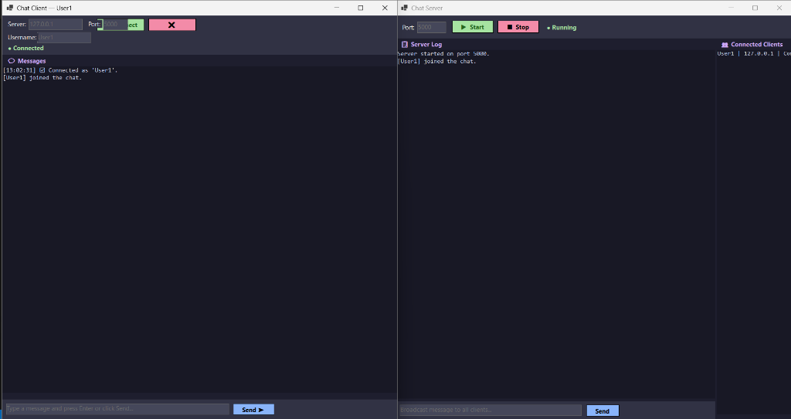
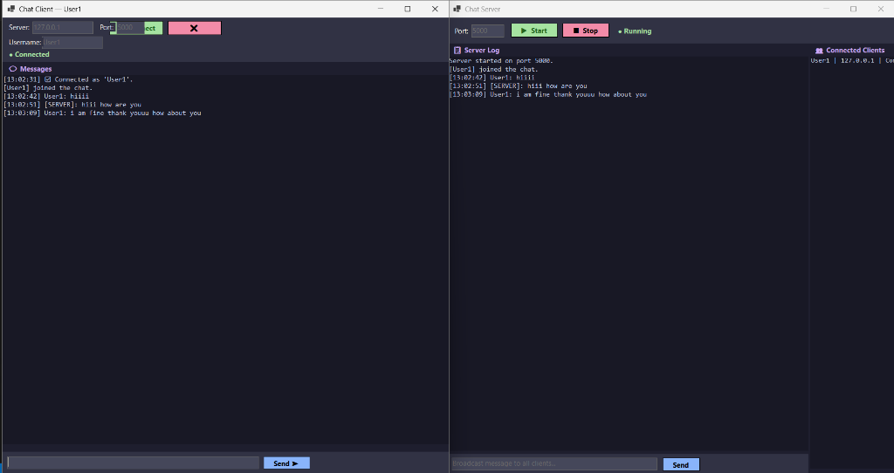

# 💬 YMH219 — Client-Server Chat Application

A real-time, multi-client asynchronous chat application built using **C#** and **.NET Windows Forms**, demonstrating object-oriented programming, raw TCP/IP socket communication, and non-blocking asynchronous UI updates.

---

## 📌 Project Overview

This project implements a complete client-server chat system where multiple client instances can connect concurrently to a central server over TCP/IP (localhost or local area network). It features dedicated controls for connection management, username handshakes, message broadcasting, live client tracking, and robust error recovery without crashing the UI.

---

## 📸 Screenshots

### 1. Connection & Active Client Tracking
The client successfully connects with a username (`User1`) and appears immediately in the server's **Connected Clients** panel displaying its username, IP address, and connection timestamp:



---

### 2. Real-Time Chat & Bidirectional Messaging
Messages sent by the client appear instantly on the server and vice versa, formatted with precise `[HH:mm:ss]` timestamps. The server can broadcast messages to all connected participants:



---

## 🚀 Core Features

- **TCP/IP Socket Networking**: High-performance socket communication powered by `TcpListener` and `TcpClient`.
- **Username Authentication Handshake**: Clients specify a unique username upon connection, registered immediately by the server.
- **Timestamped Message Feeds**: All exchanged messages include exact timestamps (`[HH:mm:ss] Username: message`).
- **Connection Lifecycle Management**: Intuitive **Connect**, **Send**, and **Disconnect** controls with dynamic button state toggling.
- **Resilient Error Handling**: Connection refusals, network interruptions, and socket disconnects are caught gracefully and reported via user dialogs without crashing the application.
- **Live Connected Clients Directory**: Server maintains and displays real-time information of all active clients (`Username | IP Address | Connected: HH:mm:ss`).
- **Server Broadcast Channel**: The server administrator can broadcast announcements directly to all connected clients.
- **Multi-Client Concurrency**: Designed to support multiple client instances operating concurrently on separate background tasks.

---

## 🛠️ Technologies Used & Dependencies

| Component | Description |
|---|---|
| **Language & Platform** | C#, .NET 11.0 / .NET 9.0 Windows Desktop SDK |
| **GUI Framework** | Windows Forms (WinForms) |
| **Networking** | `System.Net.Sockets` (`TcpListener`, `TcpClient`, `NetworkStream`) |
| **I/O Streaming** | `System.IO` (`StreamReader`, `StreamWriter`) |
| **Concurrency** | `System.Threading.Tasks` (`async`/`await`, `Task.Run`) |
| **Thread Synchronization** | `Control.Invoke()` / `InvokeRequired` for cross-thread UI marshaling |
| **NuGet Packages** | *None* — Entirely implemented using standard .NET Base Class Libraries (BCL) to keep the project lightweight and dependency-free. |

---

## 📁 Solution Architecture & File Structure

```
YMH219-ChatApp/
├── ChatApp.slnx
├── screenshots/
│   ├── connection_overview.png     # Screenshot: Connection & client list
│   └── chat_messaging_demo.png     # Screenshot: Active conversation feed
├── ChatServer/
│   ├── Program.cs                  # Server application entry point
│   ├── ServerForm.cs               # Server UI interaction & event listeners
│   ├── ServerForm.Designer.cs      # Server form controls and visual layout
│   ├── ChatServer.cs               # ChatServerCore: TcpListener & broadcast manager
│   └── ClientHandler.cs            # Manages socket I/O per connected client
└── ChatClient/
    ├── Program.cs                  # Client application entry point
    ├── ClientForm.cs               # Client UI interaction & message submission
    ├── ClientForm.Designer.cs      # Client form controls and visual layout
    └── ChatClientCore.cs           # TcpClient connection lifecycle & receive loop
```

---

## ⚙️ Installation & Running Steps

### Prerequisites
- [.NET SDK](https://dotnet.microsoft.com/download) (Version 8.0, 9.0, or 11.0+)
- Windows OS (required for Windows Forms runtime)

### 1. Clone the Repository
```bash
git clone https://github.com/mustafahaccar18-art/YMH219-ChatApp.git
cd YMH219-ChatApp
```

### 2. Build the Solution
```bash
dotnet build ChatApp.slnx
```

### 3. Launch the Server (Terminal 1)
```bash
dotnet run --project ChatServer
```
1. Set the port (default: `5000`).
2. Click **▶ Start**.
3. The status indicator will turn green (**● Running**).

### 4. Launch the Client (Terminal 2)
```bash
dotnet run --project ChatClient
```
1. Enter the server IP (use `127.0.0.1` for local testing).
2. Enter the port (e.g., `5000`) and your desired username.
3. Click **🔗 Connect**.
4. Type your message and click **Send ➤** (or press <kbd>Enter</kbd>).

*(You can open multiple terminal windows and run `dotnet run --project ChatClient` to simulate group chats between different users.)*

---

## 🌐 Connecting Across a Local Area Network (LAN)

To connect clients running on another computer within the same Wi-Fi or Ethernet network:
1. Find the server computer's local IP address:
   ```cmd
   ipconfig
   ```
   *(Look for `IPv4 Address`, e.g., `192.168.1.50`)*.
2. In the Client application on the second computer, enter the server's local IPv4 address in the **Server** field.
3. Ensure port `5000` is allowed through the server machine's Windows Defender Firewall.

---

## ⚠️ Known Limitations & Development Notes

- **Unencrypted Transport**: Communication is sent in plaintext TCP streams; TLS/SSL certificates (`SslStream`) are not configured in this educational assignment.
- **Ephemeral Message History**: Messages exist in runtime memory and are not stored in a persistent database (e.g., SQLite / PostgreSQL).
- **Network Scope**: Connecting over the public internet requires port forwarding or VPN configuration (e.g., Tailscale / Hamachi).
- **Direct P2P Messaging**: All client communications are routed through the server broadcast mechanism; direct one-to-one private whispering is a planned future enhancement.

---

## 👤 Student Information

- **Name & Surname:** Mustafa Haccar
- **Student ID:** 230541603
- **Course:** YMH219 Computer Networks (Bilgisayar Ağları) — Assignment #5
